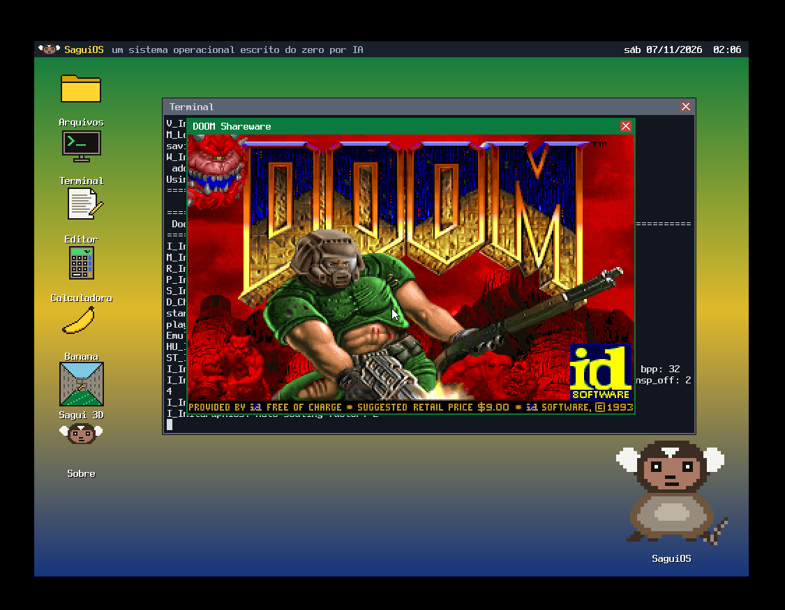

# Doomgeneric para SaguiOS

Port freestanding do [Doomgeneric](https://github.com/ozkl/doomgeneric) para o SaguiOS. O backend usa a API de janelas e teclado do sistema, e o runtime mínimo substitui partes da libc.

## Captura de tela

## Integração

Este repositório contém o diretório `userland/doom` do SaguiOS. Para integrar, copie-o para `userland/doom` no checkout do SaguiOS e aplique as regras de build documentadas em `Makefile.saguios.fragment`. O WAD não é distribuído aqui: coloque uma cópia legal do WAD shareware Doom 1.9 em `userland/doom/data/doom1.wad` antes de compilar. O checksum esperado está em `data/LEIA-ME.md`.

No SaguiOS integrado, compile com `make` e execute `doom` no shell. A janela é 640x400; a versão atual não tem áudio nem entrada por mouse.

## Código e licença

O código upstream está em `upstream/`, com o commit de origem em `upstream/UPSTREAM_COMMIT`. O port mantém os avisos e a licença GPL-2.0 em `upstream/LICENSE`. O WAD é um arquivo independente e não está coberto por essa licença.
